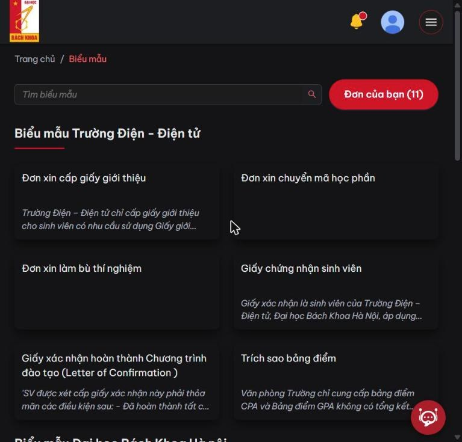

# BKHN DarkMode

Dark mode cho cổng thông tin sinh viên **QLDT HUST** ([qldt.hust.edu.vn](https://qldt.hust.edu.vn)).
Dùng được dưới dạng userscript (Tampermonkey / Violentmonkey) hoặc extension Chrome / Edge.

## Cài đặt

### Cách 1: Tampermonkey (khuyên dùng, tự cập nhật)
1. Cài [Tampermonkey](https://www.tampermonkey.net/) cho trình duyệt.
2. Mở link sau, Tampermonkey sẽ hiện trang cài đặt, bấm **Install**:
   `https://raw.githubusercontent.com/dhdh05/mytool/main/darkwebqldt/BKHN-DarkMode.user.js`
3. Vào lại QLDT là thấy giao diện tối.

Trên Chrome bản mới, cần bật **Developer mode** trong `chrome://extensions` (hoặc bật *Allow User Scripts* trong chi tiết Tampermonkey) thì userscript mới chạy.

### Cách 2: Extension (Load unpacked)
1. Tải thư mục `darkwebqldt` về máy (Code → Download ZIP rồi giải nén).
2. Mở `chrome://extensions` (Edge: `edge://extensions`), bật **Developer mode**.
3. Bấm **Load unpacked**, chọn thư mục `darkwebqldt`.

Cách này không tự cập nhật: khi có bản mới, tải lại thư mục rồi bấm nút ↻ ở extension.

## Hoạt động thế nào
Giao diện QLDT hiện tại dùng **Next.js + Ant Design v5 + Tailwind**. Dark mode có hai lớp:

- **`dark.css`**
  - Đổi bộ biến màu của Ant Design v5 (trang bật chế độ CSS variables), nên mọi bảng, menu, ô nhập, lịch, popup… tự chuyển tối.
  - Đổi bộ biến thiết kế riêng của QLDT (`--ks-*`).
  - Viết đè các class Tailwind (`bg-white`, `text-gray-*`…).
  - CSS được chèn ngay khi trang bắt đầu tải, nên không bị nháy trắng.
- **`bkhn-dark.js`** xử lý phần còn sót: style inline, class sinh ngẫu nhiên, và module khảo sát nhúng từ thư viện ngoài.
  - Nền sáng được đổi sang nền tối cùng sắc độ (trắng → xám than, xanh nhạt → xanh đậm).
  - Chữ đen được đổi sang chữ sáng; chữ màu đậm như đỏ HUST thì sáng lên để dễ đọc.
  - Chỉ quét các phần tử mới thêm vào trang (MutationObserver), nên rất nhẹ: lần quét đầu khoảng 50 ms cho khoảng 500 phần tử.

Đã kiểm tra trên các trang: trang chủ, thời khóa biểu, bảng điểm, chương trình đào tạo, đăng ký lớp, học phí, học bổng, biểu mẫu, khảo sát, câu hỏi thường gặp, menu và thông báo.

## Gặp chỗ còn trắng?
Mở issue kèm ảnh chụp và đường dẫn trang. Nếu muốn giữ nguyên màu gốc cho một phần tử nào đó, thêm thuộc tính `data-bkhn-keep` vào nó.

## Tệp
| Tệp | Vai trò |
|---|---|
| `BKHN-DarkMode.user.js` | Userscript: nạp `dark.css` và `bkhn-dark.js` từ repo |
| `dark.css` | Bảng màu tối |
| `bkhn-dark.js` | Lớp JS xử lý phần còn sót |
| `manifest.json` | Khai báo extension (Manifest V3) |
| `new-style.css`, `edit.css` | CSS của giao diện QLDT cũ (GWT), giữ lại để tham khảo |
