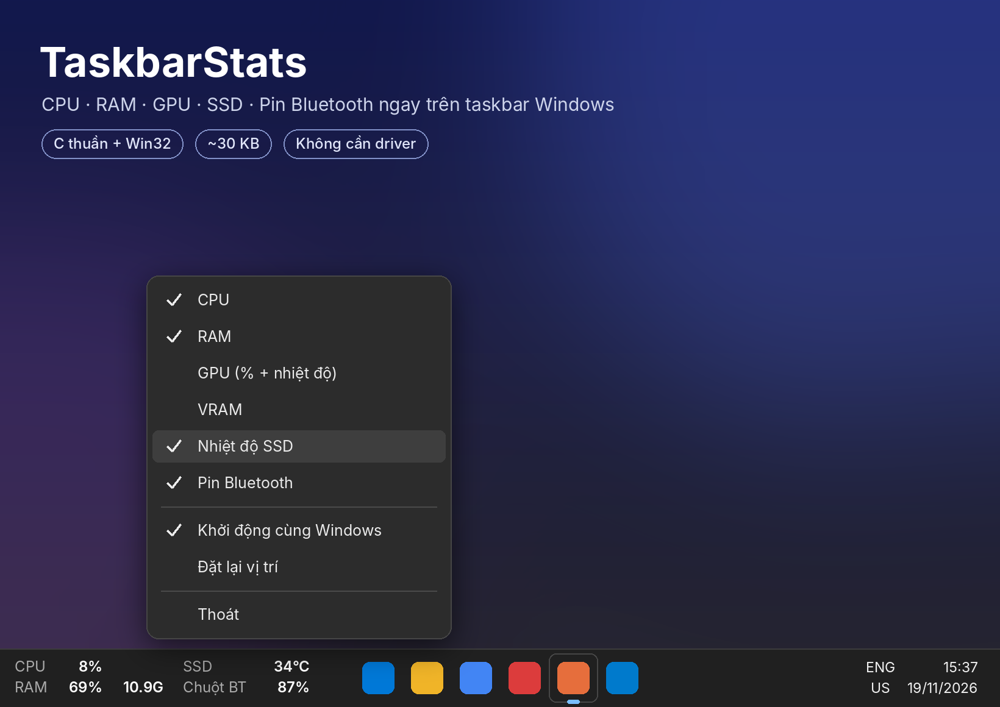
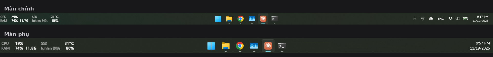

# TaskbarStats

App nhỏ hiển thị thông số máy ngay trên taskbar Windows, khỏi phải bật Task Manager.
Viết bằng C thuần + Win32 API, không cần thư viện ngoài, không cần driver, file .exe chỉ ~45 KB.



## Hiển thị gì
- **CPU**: % sử dụng (kèm nhiệt độ nếu máy có báo qua ACPI)
- **RAM**: % sử dụng + dung lượng đang dùng
- **GPU / VRAM** (tắt sẵn, bật trong menu): % GPU, nhiệt độ GPU, VRAM đang dùng (máy chỉ có GPU tích hợp thì hiện bộ nhớ GPU dùng chung)
- **SSD**: nhiệt độ + dung lượng đã dùng / tổng của ổ cài Windows, vd `SSD  30°C  178/967G` (cộng mọi phân vùng trên ổ đó: C:, D:...). Ổ gắn ngoài (USB, ổ cứng rời) chỉ hiện khi bạn bật, mỗi ổ 1 ô: `USB  29/64G`
- **Pin Bluetooth**: tên + % pin chuột / phím / tai nghe Bluetooth (lấy thiết bị pin thấp nhất, cùng nguồn với Settings > Bluetooth)
- Số liệu đổi **vàng / đỏ** khi tải cao, nóng hoặc pin yếu
- Tự đổi màu chữ theo theme sáng/tối, tự ẩn khi chơi game / xem phim full screen (chỉ ẩn trên màn đang full screen)
- **Nhiều màn hình**: hiện trên taskbar của mọi màn (cần bật *Settings → Personalization → Taskbar → Taskbar behaviors → Show my taskbar on all displays*). Cắm / rút màn là tự hiện / tự ẩn
- Không bị che khi mở Start, Search (Win+Q), Notification Center
- **Thiết bị đang kết nối** (trong menu chuột phải): màn hình nào đang cắm qua cổng gì (HDMI / DisplayPort / USB-C), thiết bị USB nào đang cắm, cắm vào cổng **Type-C hay USB-A**, có đi **qua hub** không



## Cách dùng
1. Chạy `TaskbarStats.exe` (không cần cài).
   Lần đầu Windows SmartScreen có thể chặn vì file không có chữ ký số → **More info → Run anyway**.
2. **Kéo chuột trái** để đổi vị trí trên taskbar (app tự nhớ, áp dụng cho taskbar mọi màn).
3. **Chuột phải** để mở menu:
   - **Thiết bị đang kết nối**: xem màn hình + thiết bị USB đang cắm
   - Bật/tắt từng mục hiển thị (CPU, RAM, GPU, VRAM, Ổ SSD, Pin Bluetooth)
   - **Ổ SSD ›** Nhiệt độ / Dung lượng (đã dùng / tổng) / Hiện cả ổ gắn ngoài (tắt sẵn)
   - Khởi động cùng Windows
   - Đặt lại vị trí
   - Thoát

Gợi ý: để file exe ở `%LOCALAPPDATA%\Programs\TaskbarStats\` thay vì Downloads cho khỏi xoá nhầm.

## Tự build
Cần MinGW-w64 (MSYS2) hoặc Visual Studio Build Tools. Chạy `build.bat`, hoặc:

```powershell
windres taskbarstats.rc -O coff -o taskbarstats_res.o
gcc -municode -mwindows -Os -s taskbarstats.c taskbarstats_res.o -o TaskbarStats.exe -lpdh -ldxgi -ldxguid -lgdi32 -luser32 -ladvapi32 -lsetupapi
```

> **Đừng bỏ bước `windres`.** File `taskbarstats.rc` nhúng manifest (khai báo Windows 8+) vào exe. Không có nó, Windows không cho
> tạo cửa sổ con trong suốt trên taskbar → app tự lùi về chế độ cũ: vẫn chạy nhưng bị che mỗi khi mở Start / Search.

## GPU / VRAM
Mặc định **tắt** để app nhẹ nhất (counter GPU của Windows khá tốn CPU). Bật trong menu chuột phải → **GPU** / **VRAM**.
Máy có 2 GPU (laptop iGPU + card rời) → app lấy card có VRAM riêng lớn nhất. Card rời đang ngủ thì số gần 0 là bình thường.
Máy **chỉ có GPU tích hợp** (Intel Iris Xe, Intel UHD, AMD Radeon Graphics...) không có VRAM riêng mà mượn RAM máy → ô VRAM tự đổi thành **GPU RAM**, đo bộ nhớ GPU dùng chung (giống dòng *Shared GPU memory* trong Task Manager).

## Thiết bị đang kết nối
Ví dụ menu hiện ra:
```
MÀN HÌNH
  Màn hình tích hợp   [màn laptop]
  DELL P2422H         [HDMI]
USB
  USB Receiver        [USB-A]
  USB hub             [Type-C]
        ↳ SanDisk Ultra
        ↳ USB Audio Device
```
- Chỉ quét lúc bạn mở menu, nên lúc chạy bình thường không tốn thêm RAM hay CPU.
- Chỉ liệt kê thiết bị **cắm ngoài**. Thiết bị gắn sẵn trong máy (webcam, card Bluetooth, đầu đọc vân tay...) được ẩn đi.
- Nhãn **[Type-C] / [USB-A]** lấy từ thông tin cổng mà nhà sản xuất máy khai báo trong firmware. Máy nào không khai báo thì không có nhãn.
- Màn hình cắm qua USB-C (DP Alt Mode) Windows báo là DisplayPort, nên app ghi **DisplayPort / USB-C**. Chỉ màn qua USB4/Thunderbolt mới ghi rõ USB-C.

## Cách hoạt động (tóm tắt)
- Mỗi taskbar (`Shell_TrayWnd` ở màn chính, `Shell_SecondaryTrayWnd` ở mỗi màn phụ) có 1 ô thông số riêng, gắn làm **cửa sổ con của taskbar** → taskbar lên tầng nào thì ô thông số theo tầng đó, không bị Start / Search che.
- Cảm biến được đọc ở **luồng riêng** (độ ưu tiên thấp). Luồng giao diện chỉ lấy số đã có để vẽ, nên dù một lần đọc cảm biến bị chậm hay treo thì taskbar vẫn mượt, chỉ số liệu ngừng cập nhật.
- Chỉ vẽ lại khi nội dung hoặc vị trí thay đổi; chỉ quét lại danh sách taskbar khi cắm / rút màn, Explorer khởi động lại, hoặc 5 giây một lần để dự phòng.

## Hạn chế
- Nhiệt độ CPU: Windows không có API công khai đọc nhiệt độ từng nhân (cần driver kernel). App dùng ACPI thermal zone; nhiều máy không báo → app tự ẩn ô nhiệt độ.
- Nhiệt độ GPU: cần driver WDDM 2.4+ (card NVIDIA có thêm NVML dự phòng); không có thì app chỉ hiện %.
- Nhiệt độ SSD: chạy với NVMe, một số ổ SATA/USB không hỗ trợ.
- Pin Bluetooth: chỉ thiết bị mà Windows hiện % pin trong Settings.
- Dung lượng SSD: chỉ tính các phân vùng có ký tự ổ (C:, D:...) trên ổ chứa Windows; phân vùng ẩn (EFI, Recovery) không tính. Ổ mạng và CD không tính.
- Thiết bị đang kết nối: một số máy khai báo sai cổng ngoài là "gắn trong" → thiết bị cắm ở cổng đó có thể không hiện.
- Chỉ hỗ trợ taskbar nằm ngang.
- Các màn hình dùng chung một mức scale (DPI) của màn chính; màn phụ đặt scale khác thì chữ có thể hơi mờ.

## Nguồn dữ liệu (cho ai muốn đọc code)
| Số liệu | API |
|---|---|
| CPU % | `GetSystemTimes` |
| RAM | `GlobalMemoryStatusEx` |
| GPU %, VRAM | PDH `GPU Engine` / `GPU Adapter Memory` + DXGI |
| Nhiệt độ GPU | `D3DKMTQueryAdapterInfo` (ADAPTERPERFDATA), dự phòng NVML |
| Nhiệt độ CPU | PDH `Thermal Zone Information` |
| Nhiệt độ SSD | `IOCTL_STORAGE_QUERY_PROPERTY` (`StorageDeviceTemperatureProperty`) |
| Pin Bluetooth | SetupAPI, thuộc tính PnP `{104EA319-6EE2-4701-BD47-8DDBF425BBE5} 2` |
| Dung lượng ổ đĩa | `GetDiskFreeSpaceExW`; phân vùng thuộc ổ nào: `IOCTL_VOLUME_GET_VOLUME_DISK_EXTENTS`; ổ USB: `STORAGE_DEVICE_DESCRIPTOR.BusType` |
| Màn hình + cổng | `QueryDisplayConfig` + `DisplayConfigGetDeviceInfo` (`outputTechnology`) |
| Thiết bị USB, hub | SetupAPI (cây thiết bị `USB\VID_...`, `DEVPKEY_Device_Parent`, `BusReportedDeviceDesc`) |
| Cổng Type-C / USB-A | `IOCTL_USB_GET_PORT_CONNECTOR_PROPERTIES` trên root hub |
